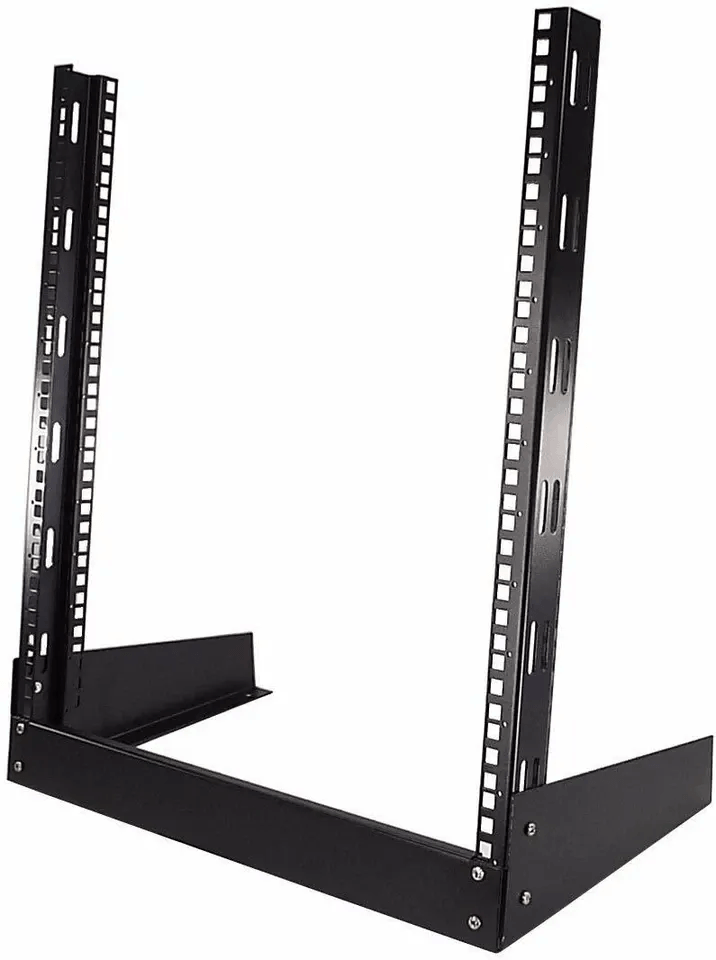
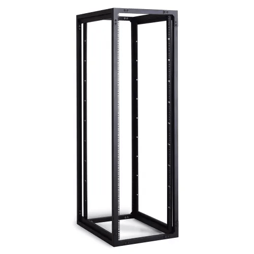
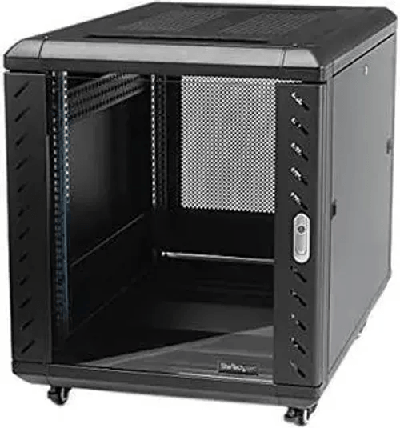
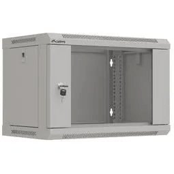
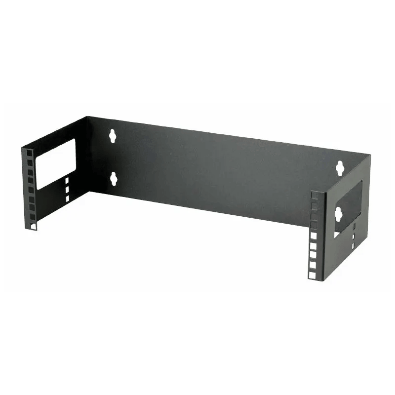

# Racks
## Racktypen
### Bauform

| Bauform           | Abbildung                                                                     |
| ----------------- | ----------------------------------------------------------------------------- |
| 2-Pfosten-Gestell |    |
| 4-Pfosten-Gestell |    |
| 4-Pfosten-Schrank |  |
| Wandschrank       |  |
| Wandgestell       |    |
